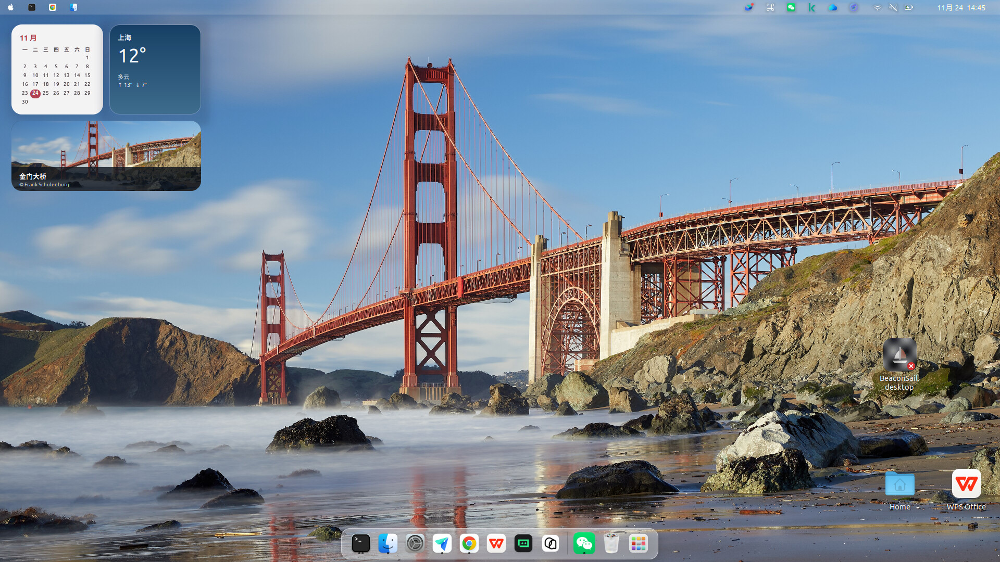
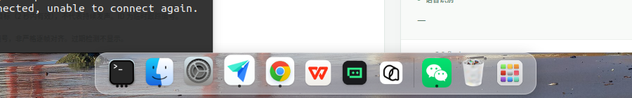
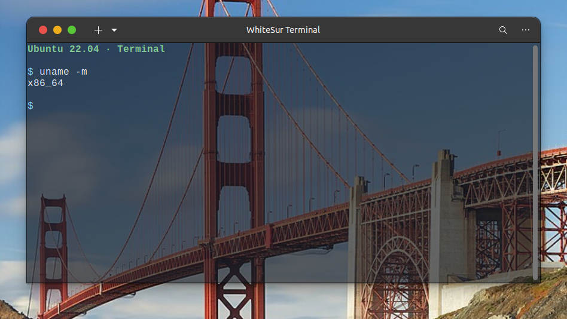
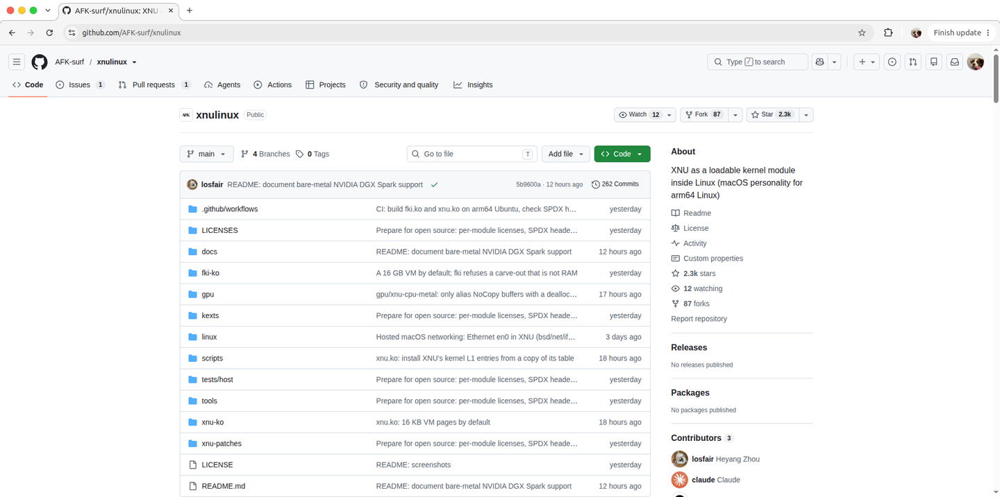

# linux-gnome-macos

[](https://www.gnome.org/)
[](LICENSE)
[-FCC624?logo=linux&logoColor=black)](#compatibility)

A reproducible, non-destructive **macOS-style GNOME desktop configuration** for Linux. It pairs the [WhiteSur](https://github.com/vinceliuice/WhiteSur-gtk-theme) visual theme with a custom GNOME Shell extension (`panel-icons@local`) that brings **authentic macOS Dock geometry**, **unclipped hover magnification**, **top-bar quick app launchers**, **desktop widgets**, and a **translucent macOS Pro terminal profile**—all with one-click install and rollback scripts.

---

## Screenshots

### Desktop Overview


### macOS Dock Hover Magnification (Unclipped)
Focused, razor-sharp icon zoom that rises cleanly above the frosted glass top border while keeping the glass shelf completely steady and running indicator dots anchored at the bottom:



### Terminal (`macOS Pro` Translucent Dark Profile)


### Browser (macOS Left Traffic-Light Window Controls)


---

## Key Features

- **Authentic macOS Dock Proportions (`65 px` height on 1080p, ~`6.0%` screen height)**
  - Narrow `5 px` bottom floating margin (matching macOS's 4–6 pt floating gap).
  - Compact `42 px` base icon size (`dash-max-icon-size=42`), proportional `17 px` corner radius, frosted translucent glass shelf, and crisp `4 px` bottom running indicator dots.
- **Smooth, Unclipped Dock Hover Magnification (`DockMagnifier`)**
  - Focused raised-cosine² curve (`1.45×` peak, `76 px` radius) so the hovered app pops out cleanly without bloating the whole row.
  - Pre-rasterizes `St.Icon` textures at the magnified target size (`~61 px`) so zoomed icons stay **pixel-sharp** instead of upscaled and blurry.
  - Bypasses both `St.ScrollView` C-level viewport clipping and `DashSlideContainer.vfunc_allocate`'s post-allocation `set_clip()`, allowing zoomed icons to rise naturally above the Dock's top border.
  - Keeps the frosted glass shelf rock-solid (`scale_x = 1.0`, zero jitter) and running dots anchored at the bottom baseline.
- **macOS-Style Top Bar & Quick App Launchers**
  - Replaces the GNOME "Activities" text label with a clean Apple menu icon, hides the redundant app-menu text, and moves the clock/date widget to the right corner.
  - Adds top-bar quick launchers (Terminal, Chrome, Files) with single-click focus/launch, multi-window switcher dropdowns, and live Braille spinner status badges parsed from window titles.
- **Desktop Widgets**
  - Clean frosted-glass monthly Calendar card, live Weather card (via `wttr.in`), and Photo widget rendered on the desktop background layer.
- **Window Controls & Terminal**
  - Left-aligned macOS traffic-light buttons (`close,minimize,maximize:`).
  - `macOS Pro` GNOME Terminal profile with subtle transparency (`10%`), dark headerbar, hidden menubar, and macOS color palette.
- **Safe & Reversible**
  - `install.sh` automatically backs up existing `dconf` settings to `~/.local/share/linux-gnome-macos/backup` before making any changes.
  - `restore.sh` cleanly disables/removes the extension and restores your previous desktop configuration.

---

## macOS Dock Design Specifications

Comparison on a standard `1920 × 1080` (`1×` scale) display:

| Metric | Default Ubuntu Dock + WhiteSur | Apple macOS HIG (Sonoma / Sequoia) | `linux-gnome-macos` |
| --- | --- | --- | --- |
| Bottom floating margin | ~16 px | 4–6 pt | **5 px** |
| Base icon size (`tilesize`) | 48 px | 36–48 pt | **42 px** |
| Total resting Dock height | 96 px (8.9% of 1080p) | 55–70 pt (~6%–7%) | **65 px (6.0%)** |
| Container corner radius | 24 px | Proportional (~28% of height) | **17 px** |
| Running indicator dot | Scales with button | Fixed 4 pt dot at shelf bottom | **Fixed 4 px dot** |
| Hover magnification | Not supported in Ubuntu Dock | Unclipped upward pop-out | **1.45× sharp unclipped pop-out** |

---

## Compatibility

This configuration targets **GNOME Shell**, not exclusively Ubuntu:

| Environment | Status | Notes |
| --- | --- | --- |
| **Ubuntu 22.04 LTS** (GNOME 42, X11) | Verified | Uses built-in `ubuntu-dock@ubuntu.com` (same `dash-to-dock` dconf schema) |
| **Debian 12 / Fedora 36–38 / Arch** (GNOME 40–44) | Supported | Requires [Dash to Dock](https://extensions.gnome.org/extension/307/dash-to-dock/) and [User Themes](https://extensions.gnome.org/extension/19/user-themes/) |
| **GNOME 45+** (Ubuntu 24.04, newer Fedora/Arch) | Needs ESM port | GNOME 45 migrated extensions from `imports.gi` to ES Modules (`import ... from 'resource:///...'`) |
| **KDE Plasma / XFCE / Hyprland** | Not applicable | Extension is written specifically for GNOME Shell (`St` / `Clutter`) |

---

## Quick Start

### 1. Prerequisites (Optional but Recommended for Full macOS Look)

Install the [WhiteSur GTK Theme](https://github.com/vinceliuice/WhiteSur-gtk-theme) and [WhiteSur Icon Theme](https://github.com/vinceliuice/WhiteSur-icon-theme) plus GNOME Shell `User Themes` extension:

```bash
# WhiteSur GTK & Shell Theme
git clone https://github.com/vinceliuice/WhiteSur-gtk-theme.git --depth=1
./WhiteSur-gtk-theme/install.sh -l -c Light

# WhiteSur Icon Theme
git clone https://github.com/vinceliuice/WhiteSur-icon-theme.git --depth=1
./WhiteSur-icon-theme/install.sh
```

> On non-Ubuntu GNOME distros, also install and enable **Dash to Dock** (`dash-to-dock@micxgx.gmail.com`) and **User Themes** (`user-theme@gnome-shell-extensions.gcampax.github.com`).

### 2. Install `linux-gnome-macos`

```bash
git clone https://github.com/xxxylw/linux-gnome-macos.git
cd linux-gnome-macos
chmod +x install.sh restore.sh
./install.sh
```

Available flags:
- `--no-wallpaper` — keep your current desktop wallpaper
- `--no-terminal` — skip importing the `macOS Pro` GNOME Terminal profile
- `--no-theme` — skip modifying GTK / Icon / Shell theme keys

### 3. Reload GNOME Shell

- **X11**: press `Alt + F2`, type `r`, and press `Enter` (or run `killall -HUP gnome-shell`).
- **Wayland**: log out and log back in.

---

## Uninstall & Restore

To cleanly revert everything back to your pre-install backup (or GNOME defaults):

```bash
./restore.sh
```

Then reload GNOME Shell (`Alt + F2` → `r` on X11, or log out/in on Wayland).

---

## Project Structure

```text
linux-gnome-macos/
├── README.md
├── LICENSE
├── install.sh                                   # One-click backup & installer
├── restore.sh                                   # One-click rollback / uninstaller
├── configs/
│   ├── dock.dconf                               # Dash-to-Dock / Ubuntu Dock geometry keys
│   └── terminal-macos-pro.dconf                 # GNOME Terminal translucent dark profile
├── extensions/
│   └── panel-icons@local/
│       ├── metadata.json                        # GNOME Shell 40-44 extension manifest
│       ├── extension.js                         # Top bar, quick apps, widgets, DockMagnifier
│       ├── stylesheet.css                       # .macos-dock geometry & widget styles
│       ├── apple.svg                            # Top-left menu icon
│       └── photo-credit.txt                     # Wallpaper attribution
└── assets/
    ├── wallpapers/
    │   ├── golden-gate-marshalls-beach.jpg      # 4K UHD wallpaper (CC BY-SA 4.0)
    │   └── CREDITS.md
    └── screenshots/
        ├── desktop.jpg
        ├── dock-magnification.png
        ├── terminal.png
        └── browser.png
```

---

## Customization

All tuning constants live at the top of `extensions/panel-icons@local/extension.js`:

- **Dock magnification**: `DOCK_MAX_SCALE` (`1.45`), `DOCK_SPREAD_RADIUS` (`76`), `DOCK_LERP_ALPHA` (`0.30`), `DOCK_LIFT_PX` (`1`).
- **Top-bar quick apps**: edit the `QUICK_APPS` array (Terminal, Chrome, Files by default).
- **Weather widget city**: edit `WEATHER_URL` (defaults to `https://wttr.in/Shanghai?format=j1`).
- **Base Dock icon size**: `gsettings set org.gnome.shell.extensions.dash-to-dock dash-max-icon-size 42` (recommended range: `38`–`46`).

---

## Credits & License

- **Code & Configuration**: Licensed under the [MIT License](LICENSE).
- **GTK / Icon Theme**: Designed to pair with [WhiteSur-gtk-theme](https://github.com/vinceliuice/WhiteSur-gtk-theme) and [WhiteSur-icon-theme](https://github.com/vinceliuice/WhiteSur-icon-theme) by [@vinceliuice](https://github.com/vinceliuice).
- **Wallpaper**: *Golden Gate Bridge as seen from Marshall's Beach, March 2018* by © Frank Schulenburg, licensed under [CC BY-SA 4.0](https://creativecommons.org/licenses/by-sa/4.0/) via [Wikimedia Commons](https://commons.wikimedia.org/wiki/File:Golden_Gate_Bridge_as_seen_from_Marshall%E2%80%99s_Beach,_March_2018.jpg).
